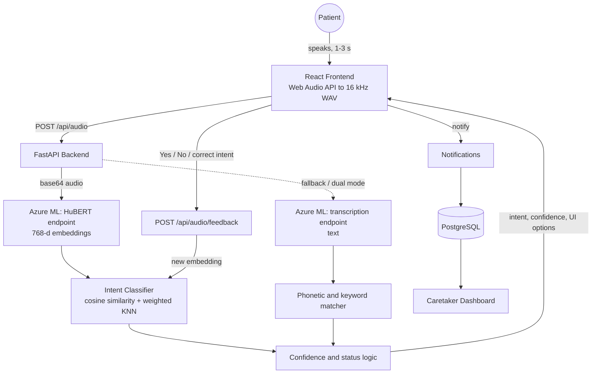

# VerbaOS: Speech-to-Intent Assistive System for Stroke and Aphasia Patients

> Patients with impaired speech say a short sound or word. VerbaOS turns it into an actionable intent (water, pain, bathroom, emergency, and more), asks for a quick confirmation, learns from the answer, and alerts their caretakers.


**Demo video:** https://youtu.be/izxetPTsxkE

---

## The VerbaOS Repositories

VerbaOS was built in three stages across four repositories. This repo is the documentation hub that links them together.

| Stage | Repository | What it contains |
|---|---|---|
| **1. Planning and prototype** | [**IntentJizz**](https://github.com/shrey1184/IntentJizz) | Problem framing, hierarchical intent-menu UX design, onboarding flow, architecture and deployment docs, and a working MVP (FastAPI + React) with a simulated classifier used to validate the interaction design before any real model existed. |
| **2. Model deployment** | [**Hubert-Production**](https://github.com/shrey1184/Hubert-Production) | First deployment of the HuBERT model (`facebook/hubert-base-ls960`) as an Azure ML managed online endpoint: endpoint creation, environment, and scoring script that returns audio embeddings. |
| **2. Model deployment** | [**Azure-SpeechIntent**](https://github.com/shrey1184/Azure-SpeechIntent) | Refined Azure ML deployment package: deployment configs, conda environment, and the scoring scripts for both models (HuBERT embeddings with mean pooling, and a CTC transcription endpoint). |
| **3. Final product** | [**VerbaOS**](https://github.com/shrey1184/VerbaOS) | The complete application: FastAPI backend, intent classification engine, learning loop, patient and caretaker React apps. |
| **Docs hub** | [**VerbaOS-module**] (https://github.com/shrey1184/verbaOS-module) | Overview, architecture, and links to everything above. |

```
 Plan & prototype          Deploy the models             Build the product
┌────────────────┐       ┌────────────────────┐       ┌────────────────────────┐
│  IntentJizz    │  ───▶ │ Hubert-Production  │  ───▶ │        VerbaOS         │
│ UX + MVP design│       │ Azure-SpeechIntent │       │ Backend + Frontend +   │
│                │       │ (Azure ML endpoints)│      │ Learning loop + Carers │
└────────────────┘       └────────────────────┘       └────────────────────────┘
```

---

## The Problem

After a stroke, many people develop aphasia or dysarthria. They know what they want but cannot say it clearly. Conventional speech-to-text fails because it expects clear articulation and a large vocabulary, so patients cannot call for water, report pain, or signal an emergency.

## The Approach

VerbaOS does not try to transcribe free speech. It treats the problem as **intent classification** over a small, safety-critical vocabulary, and it is **personalised**: the system learns each patient's own way of saying things.

1. **Record** a short clip (up to 3 seconds) in the browser.
2. **Embed** it with HuBERT on Azure ML, which captures acoustic patterns even when words are unclear.
3. **Classify** it by cosine similarity against stored examples of each intent.
4. **Confirm** with the patient or caretaker using yes/no buttons.
5. **Learn** from that answer, so the next attempt is more accurate.
6. **Notify** the patient's caretakers.

---

## What I Built

- **Azure ML online endpoints**: created managed online endpoints and deployed the HuBERT and transcription models with custom scoring scripts, environments, and instance configs.
- **Intent classification engine**: embedding-based classifier (centroid + weighted KNN + best-match scoring) with calibrated confidence scores.
- **Two-model support**: HuBERT as the primary model, a transcription model as a fallback, and an optional dual-model mode that combines both predictions.
- **Confidence scoring**: calibrated confidence with threshold-based status logic (confirmed, needs confirmation, uncertain, auto-triggered).
- **Learning loop**: yes/no feedback with an intent-correction flow that feeds new embeddings back into the classifier.
- **Recording feature**: 16 kHz mono Web Audio capture with auto-stop at 3 seconds and in-browser WAV encoding.
- **UI**: neumorphic React interface with dark/light themes, live audio visualiser, quick actions, patient and caretaker dashboards, and a visitor counter.
- **Caretaker system**: roles, patient-to-caretaker linking, and notifications.

---

## System Architecture



---

## How Classification Works

### 1. Embeddings from HuBERT

The HuBERT endpoint (`facebook/hubert-base-ls960`) resamples the audio to 16 kHz, runs the model, and returns the **mean-pooled last hidden state: a 768-dimensional embedding** for the clip. Because it represents *how the sound is produced* rather than which words were said, it works for slurred, partial, or non-verbal utterances.

### 2. Matching against stored examples

For each intent that has at least 2 stored examples, the classifier computes:

| Signal | Weight | Meaning |
|---|---|---|
| Centroid similarity | 0.3 | Cosine similarity to the average embedding of the intent |
| Weighted KNN score (K = 5) | 0.5 | Top-5 nearest examples, weighted by squared similarity |
| Best single match | 0.2 | Highest cosine similarity to any one example |

### 3. Calibrated confidence

Raw scores are converted to a more honest confidence value:

- 20% penalty when the margin between the top two intents is below 0.05 (ambiguous)
- 15% penalty when an intent has fewer than 5 examples, 5% when it has fewer than 10
- Predictions are re-sorted after calibration, and the top 3 are returned as alternatives

### 4. Status and next action

| Confidence | Status | Next action |
|---|---|---|
| `EMERGENCY` above 0.8 | `auto_triggered` | Trigger alert immediately |
| 0.75 or higher | `confirmed` | Await user confirmation (YES/NO resolve directly) |
| 0.4 to 0.75 | `needs_confirmation` | Show options and alternatives |
| below 0.4 | `uncertain` | Ask the patient to repeat |

---

## Two-Model Design

VerbaOS deploys two models on Azure ML and uses them in two ways.

**Default (failover):** HuBERT is the primary model. If its endpoint fails or times out, the backend automatically falls back to the transcription endpoint, which converts speech to text and matches it using a phonetic and keyword matcher tuned for aphasia patterns (consonant deletion, vowel substitution, and so on).

**Dual-model mode:** call `POST /api/audio?hybrid_mode=true` to run **both models on the same audio and combine the results**:

| Situation | Result |
|---|---|
| Both models agree | Confidence is a 0.6 / 0.4 weighted blend (HuBERT / transcription), boosted by 15% |
| Models disagree | The higher weighted score wins and its confidence is reduced by 15% |
| Only one model responds | That model's result is used |

This lets the second model confirm or challenge the first, which is especially useful when the patient's speech is partly intelligible.

---

## The Learning Loop

Every classification comes with an `embedding_id`. After each result the patient or caretaker sees **Yes / No** buttons:

- **Yes**: the embedding is stored under the predicted intent. The system has just learned another example of how this patient says that intent.
- **No**: the UI asks which intent was meant (dropdown of all intents), and the embedding is stored under the corrected intent.

Intent centroids are recomputed whenever examples are added, so improvements take effect on the next request, **without retraining any model**. Manual training endpoints (`/api/audio/train/single`, `/api/audio/train/batch`) let you bulk-load labelled recordings.

---

## Patient and Caretaker Experience

- **Role selection**: users register as a **patient** or a **caretaker**.
- **Patient dashboard**: one big record button, a live audio visualiser, the detected intent with its confidence, quick-action buttons (Water, Food, Restroom, Pain, Emergency), and the Yes/No feedback panel. Each detected request is sent as a notification to every linked caretaker.
- **Caretaker dashboard**: link to one or more patients, see incoming requests with the patient's name, intent, and confidence, mark them as read, and view an emergency count. Notifications refresh automatically every 5 seconds.
- **Many-to-many links**: a patient can have several caretakers (nurse, parent, sibling) and a caretaker can look after several patients.
- **Visitor counter**: a live count of unique visitors shown in the UI.

---

## Supported Intents

| Intent | Meaning | UI options |
|---|---|---|
| `HELP` | Needs assistance | Confirm Help, Cancel |
| `EMERGENCY` | Urgent medical situation | Cancel Emergency |
| `WATER` | Thirst | Confirm Water, Cancel |
| `PAIN` | Discomfort | Confirm Pain, Where?, Cancel |
| `BATHROOM` | Toileting | Confirm Bathroom, Cancel |
| `TIRED` | Needs rest | Confirm Rest, Cancel |
| `COLD` / `HOT` | Temperature | Confirm Cold / Hot, Cancel |
| `YES` / `NO` | Answer to a question | OK |
| `UNKNOWN` | Not understood | Repeat, Cancel |

---

## API Overview

| Method | Endpoint | Purpose |
|---|---|---|
| `POST` | `/api/audio` | Classify a WAV clip (add `?hybrid_mode=true` for dual-model mode). Rate limited to 10 requests per minute per IP. |
| `GET` | `/api/audio/requirements` | Audio format requirements for the client |
| `POST` | `/api/audio/feedback` | Yes/No feedback with optional corrected intent (learning loop) |
| `POST` | `/api/audio/confirm` | Confirm an intent and store its embedding |
| `GET` | `/api/audio/intents` and `/api/audio/intents/list` | Stored-example statistics and the list of intents |
| `POST` | `/api/audio/train/single` and `/api/audio/train/batch` | Load labelled training audio |
| `DELETE` | `/api/audio/train/{intent}` | Clear an intent's stored examples |
| `POST` | `/api/audio/recompute-centroids` | Rebuild intent centroids |
| `GET` | `/api/health` | Service health and reachability of each ML endpoint |
| `GET` / `POST` | `/api/visitors`, `/api/visitors/register` | Visitor counter |
| `POST` / `GET` | `/api/users/register`, `/api/users/{id}` | User registration and lookup |
| `POST` / `DELETE` | `/api/users/patients/{id}/link-caretaker`, `.../unlink-caretaker/{id}` | Link or unlink a patient and caretaker |
| `GET` | `/api/users/patients/{id}/caretakers`, `/api/users/caretakers/{id}/patients` | List relationships |
| `POST` / `GET` | `/api/users/notifications`, `/api/users/caretakers/{id}/notifications` | Send and read notifications |
| `POST` | `/api/users/notifications/{id}/read` | Mark a notification as read |

Interactive docs are available at `/docs` (Swagger) and `/redoc` when the backend is running.

### Example response

```json
{
  "intent": "WATER",
  "confidence": 0.89,
  "status": "confirmed",
  "ui_options": ["Confirm Water", "Cancel"],
  "next_action": "await_user_confirmation",
  "transcription": null,
  "alternatives": ["HELP", "PAIN"],
  "embedding_id": "3f1c...",
  "model_used": "HuBERT",
  "top_predictions": [{"intent": "WATER", "confidence": 0.89}]
}
```

---

## Audio Requirements

| Parameter | Value |
|---|---|
| Format | WAV |
| Sample rate | 16,000 Hz |
| Channels | Mono |
| Bit depth | 16-bit |
| Max duration | 3 seconds (the frontend auto-stops recording) |
| Max size | 1 MB |

---

## Tech Stack

| Layer | Technologies |
|---|---|
| **Models** | HuBERT (`facebook/hubert-base-ls960`), Wav2Vec2-family CTC transcription, Hugging Face Transformers, PyTorch |
| **Cloud** | Azure ML managed online endpoints, Azure Database for PostgreSQL (pgvector) |
| **Backend** | Python, FastAPI, Uvicorn, httpx, NumPy, asyncpg, SlowAPI (rate limiting), Pydantic |
| **Frontend** | React 19, Vite, Tailwind CSS 4, Framer Motion, Radix UI, Axios, Web Audio API |
| **Hosting** | Frontend configured for Vercel; backend served with Uvicorn |

---

## Data Storage

- **Intent embeddings** (the learning loop) are stored in `intent_embeddings.json` and loaded into memory at startup.
- **Users, patient-caretaker links, and notifications** are stored in Azure PostgreSQL.
- A **pgvector** schema (`schema.sql`) and a migration script (`migrate_to_postgres.py`) are included for moving the embedding store into PostgreSQL with native cosine search.
- Raw audio is never stored. Only embeddings and metadata are kept.

---

## Getting Started

Each stage has its own setup instructions in its repository:

1. **Deploy the models** with [Azure-SpeechIntent](https://github.com/shrey1184/Azure-SpeechIntent) (or [Hubert-Production](https://github.com/shrey1184/Hubert-Production)). Copy `config.template.json` to `config.json`, run `az login`, then use `HF.ipynb` to create the endpoint and deployment. Note each endpoint's scoring URL and key.
2. **Run the product** from [VerbaOS](https://github.com/shrey1184/VerbaOS):

```bash
# Backend
cd Backend
python -m venv venv && source venv/bin/activate
pip install -r requirements.txt
# create .env with:
#   REST_END_POINT__HUBERT, PRIMARY_KEY__HUBERT
#   REST_END_POINT__WAVE2VEC, PRIMARY_KEY__WAVE2VEC
#   DATABASE_URL (Azure PostgreSQL)
uvicorn main:app --reload --host 127.0.0.1 --port 8000

# Frontend (new terminal)
cd frontend
npm install
echo "VITE_API_URL=http://127.0.0.1:8000" > .env
npm run dev
```

3. Open http://localhost:5173, choose a role, and try recording.

---

## Evaluation

Intent classification reached **73% accuracy on 150 audio samples across 8 intent categories**, against roughly 12% for a random baseline (about 5.8x better), using HuBERT embeddings and cosine-similarity matching.

The system is designed to improve with use: each confirmed or corrected prediction adds a new reference example without retraining.

---

## Roadmap

- Enable dual-model mode by default in the frontend (currently opt-in through `?hybrid_mode=true`)
- Move the embedding store from JSON to PostgreSQL with a pgvector index
- Per-patient embedding stores, so each patient gets a personalised classifier
- A reproducible evaluation script with a published test set
- Multilingual intent vocabularies

---

## Acknowledgements

- Microsoft Azure ML for model hosting
- The HuBERT and Wav2Vec2 research teams at Meta AI
- Built for the Microsoft Imagine Cup
